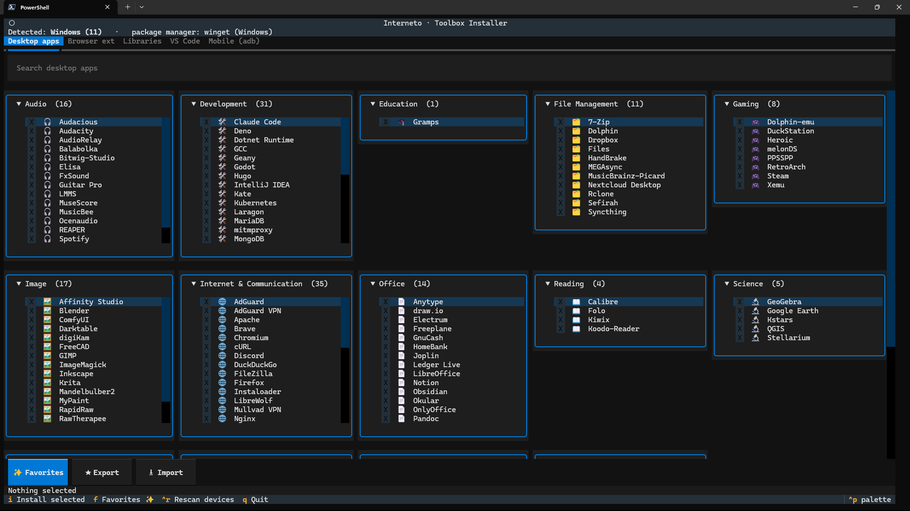

# Interneto · Toolbox Installer (TUI)

A cross-platform terminal app that brings the Interneto toolbox installers to
your terminal. It **autodetects your operating system and package manager**,
lets you multi-select packages just like the web UI, and then **actually runs the
install** instead of handing you a command to copy/paste.

## What it installs

| Surface            | How it installs                                                                                              | Availability                   |
|--------------------|--------------------------------------------------------------------------------------------------------------|--------------------------------|
| Desktop apps       | Native package manager (`pacman`, `apt`, `dnf`, `zypper`, `emerge`, `apk`, `xbps`, `pkg`, `brew`, `winget`, `flatpak`, `snap`, `nix`), first available manager that has the package | Autodetected desktop OS        |
| Libraries          | Per-language manager (`npm`, `pip`, …)                                                                       | Desktop                        |
| VS Code extensions | `code --install-extension`                                                                                   | Desktop (needs the `code` CLI) |
| Browser extensions | Downloads the `.xpi` (Firefox) / `.crx` (Chromium) and opens it so the browser installs it                   | Desktop                        |
| Mobile (Android)   | Deep-links each Play Store page on a connected device over `adb`                                             | When a device is attached      |
| AI agents (MCP/plugins) | Runs each entry's `claude`/`codex`/`copilot`/`npx` install command for the CLI you pick               | Detected agent CLI, or `npx`   |

The package lists are the **same JSON** the web toolbox ships in its
`public/pkgs/`, bundled into the app. Re-sync them from a sibling
`interneto-website/` checkout via `python scripts/sync_pkgs.py`.

## Install & run

**One-liner** (installs [uv](https://docs.astral.sh/uv/) if needed, then the app from GitHub, then launches it):

```powershell
# Windows (PowerShell)
irm https://raw.githubusercontent.com/interneto/tui-toolbox-installer/main/scripts/install.ps1 | iex
```

```bash
# macOS / Linux
curl -fsSL https://raw.githubusercontent.com/interneto/tui-toolbox-installer/main/scripts/install.sh | sh
```

The one-liner installs the **tagged release** named in the script (`v0.1.0` today),
not whatever is on `main`. To try another tag, branch or commit, set
`INTERNETO_REF` first (`INTERNETO_REF=main` in sh, `$env:INTERNETO_REF = 'main'` in
PowerShell). Releasing means bumping `version` in `pyproject.toml` and the
`VERSION` / `$Version` lines of both scripts together; a test fails if they drift.

Already have **uv**? Skip the bootstrap:

```bash
uvx --from git+https://github.com/interneto/tui-toolbox-installer interneto-install   # run once, no install
uv tool install git+https://github.com/interneto/tui-toolbox-installer                # install the command
```

**From a local checkout** (development):

```bash
python -m venv .venv && . .venv/bin/activate   # Windows: .venv\Scripts\activate
pip install -e ".[dev]"      # app + test tooling
interneto-install            # launch the TUI
interneto-install --detect   # just print what was autodetected
pytest                       # run the smoke tests
```

Re-running either one-liner upgrades to the latest version.

## Headless / clean reinstall

The TUI is the default when a person is at the keyboard. For a machine you
just reinstalled, the same favorites can be applied without the TUI:

```bash
# 1. Inspect the plan; nothing runs.
interneto-install --favorites perfil.json --surface desktop --dry-run

# 2. Machine-readable plan for a script/CI step.
interneto-install --favorites perfil.json --surface desktop --dry-run --json

# 3. Apply the desktop profile, skipping what is already installed.
interneto-install --favorites perfil.json --surface desktop \
  --only-missing --yes --log rebuild.log

# 4. Apply every surface the profile covers.
interneto-install --favorites perfil.json --surface all --yes

# 5. Persist progress, then resume after a failure/reboot.
interneto-install --favorites perfil.json --surface desktop --yes --state rebuild.json
interneto-install --favorites perfil.json --surface desktop --yes --state rebuild.json --resume
```

- `--surface` is repeatable (`desktop`, `vscode`, `lib`, `browser`, `mobile`,
  `all`) and defaults to `desktop`.
- **`--yes` is required to change anything.** Without it the plan is printed
  and the process exits `2`; `--dry-run` exits `0` without touching the machine.
- `--only-missing` reads the native inventory (`winget export`, `brew list`,
  `dpkg-query`, `pacman -Qq`, `rpm -qa`, `flatpak list`, `snap list`,
  `pkg query`, `code --list-extensions`, `adb shell pm list packages`). Nix
  attributes and language libraries have no reliable inventory, so their
  favorites are installed as-is.
- Failures do not stop the batch by default; `--fail-fast` stops at the first
  one. Exit codes: `0` ok, `1` at least one command failed, `2` usage error or
  missing `--yes`/favorites file.
- `--json` prints one report object and keeps stdout clean; `--log PATH`
  writes the full text log. The two can be combined.
- `--state PATH` records each command that finishes successfully;
  `--resume` skips those on the next run (default state:
  `~/.config/interneto-install/last-run.json`, `%LOCALAPPDATA%` on Windows).
  State is command-level: a grouped `apt` command is either done or retried as
  a whole, which is safe because package managers are idempotent.
- `--android-serial SERIAL` picks the device for the `mobile` surface when
  more than one is attached. With `--surface mobile` alone, omitting it is an
  error; with `--surface all` the first device is used and reported.
- Browser extensions are downloaded and opened for the browser to install;
  mobile surfaces need a connected device with `adb`. Neither is silent.

## Keys

- Packages are grouped into collapsible category sections (with an icon per row),
  laid out in a responsive grid of up to five columns. Sections are expanded by
  default; collapse a header to tuck a category away.
- Type to search, `space` to toggle a package, `enter` to expand/collapse a section, arrows to move.
- `i` — install the selected packages in the active tab (shows the exact commands first).
- `f` / **✨ Favorites** — select this section's favorite packages in one go.
- `Ctrl+R` — rescan for Android devices.
- `Esc` while installing — stop the current run (kills the process tree, then closes).
- `q` — quit.

## Favorites

The **✨ Favorites** button (or `f`) selects a curated set of packages for the
active tab. Each surface (desktop, VS Code, libraries, browser, mobile) has its
own list. The shipped defaults live in `interneto_install/data/favorites.json`.

Make them your own:

- **★ Export** writes the current tab's selection as the favorites for that
  surface to a per-user config file (`<config dir>/interneto-install/favorites.json`;
  on Windows that is `%LOCALAPPDATA%\interneto-install\favorites.json`, because
  `platformdirs` uses the local—not roaming—AppData folder). Other surfaces are
  preserved. A user file is merged over the bundled defaults per surface, so a
  file that only lists `desktop` does not wipe the other tabs.
- **⭳ Import** reloads that file (handy after editing it by hand) and applies the
  active tab's favorites. When the file is absent, the bundled defaults are used.
  If it exists but is invalid, the app warns instead of silently using defaults.
- Keep the profile somewhere else (e.g. a toolbox checkout) with
  `interneto-install --favorites /path/to/favorites.json`, or set
  `INTERNETO_FAVORITES`. `interneto-install --detect` prints the path in use.

## Notes

- Desktop installs use your system package manager and may prompt for `sudo`.
  The app always shows the exact commands and asks for confirmation before running.
- A package is installed by the **first detected manager that has it** (the
  primary one, then the fallbacks found on PATH). That is how a flatpak- or
  snap-only app is still offered on a Debian/Fedora box; the confirmation
  screen says which managers will be used.
- Linux detection reads `/etc/os-release` (`ID`/`ID_LIKE`), so openSUSE,
  Alpine, Void and NixOS are labelled correctly. On an immutable Fedora
  (`/run/ostree-booted`) dnf is not used; flatpak is preferred. The catalog
  has no zypper/apk/xbps package names yet, so those hosts fall back to
  flatpak/snap.
- After a run, the app re-reads the Windows PATH from the registry and adds
  the usual tool directories (uv, cargo, pnpm, brew, VS Code CLI, Nix) so a
  later tab or surface in the same session can find what was just installed.
- Some apt names need a third-party repository (`code`, `discord`,
  `spotify-client`, `virtualbox`...). The app does not add repositories; it
  flags them in the confirmation note via
  `interneto_install/data/apt-external-repos.json` so a failure is explainable.
- Android: when several devices are connected the mobile tab shows a selector;
  in headless mode pass `--android-serial SERIAL` (required if more than one
  device is attached and `mobile` is the only surface).
- On macOS, GUI apps are installed with `brew install --cask` using
  `interneto_install/data/brew-casks.json`. That list is generated from the
  Homebrew API with `python scripts/sync_brew_casks.py`; re-run it after the
  catalog changes.
- Browser extensions are downloaded as `.xpi` (Firefox, from addons.mozilla.org)
  or `.crx` (Chromium, from Google's update service) into your Downloads folder,
  then opened so the browser runs its own install prompt. Firefox asks you to
  confirm the add-on; Chrome may refuse a `.crx` that didn't come from the Web Store.
- Android apps can't be silently installed from the CLI, so that surface opens the
  official Play Store pages for the final one-tap install.
- AI agent entries fall back through claude → codex → copilot → npx like the web
  toolbox does; two things get skipped rather than misfired: entries needing an
  env var you haven't set (e.g. `$AFFINITY_MCP_URL`), and entries whose only command
  for the chosen CLI is a `/plugin ...` slash command meant to be pasted into an
  already-running agent session, not run as a shell command. Both show up in the
  confirmation screen's footnote so you know what to do by hand.

## Screenshot


